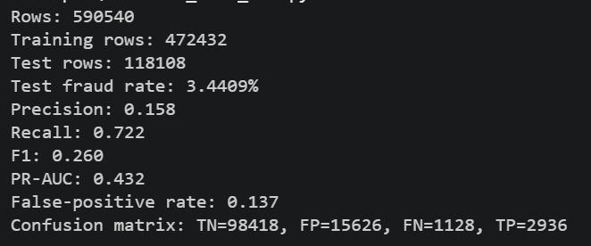
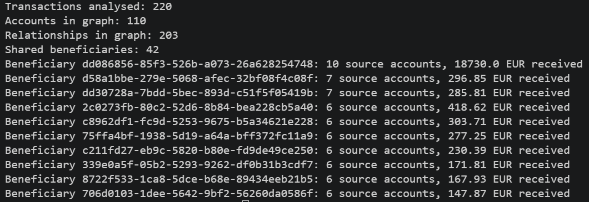

# Payment Risk Engine

A Python prototype for detecting unusual payment behaviour. It combines transaction validation, behavioural feature engineering, unsupervised anomaly detection, and a FastAPI scoring service.

## What it does

- Validates transaction data with Pydantic
- Builds features for amount, time, transaction velocity, country changes, and transaction type
- Trains an Isolation Forest on normal transaction behaviour
- Trains a supervised fraud classifier on IEEE-CIS transaction data
- Builds a directed account-to-beneficiary graph with NetworkX
- Ranks shared beneficiaries by connected source accounts and received volume
- Scores transactions in batch or through an HTTP API
- Returns an `allow` or `review` decision with an explanation
- Evaluates predictions with precision, recall, F1, PR-AUC, and false-positive rate
- Uses labelled synthetic data for reproducible experiments
- Handles class imbalance with balanced sample weights and a temporal evaluation split

## Quick start

```powershell
py -3.14 -m venv .venv
& ".\.venv\Scripts\python.exe" -m pip install -e ".[dev]"
& ".\.venv\Scripts\python.exe" scripts\generate_transactions.py
& ".\.venv\Scripts\python.exe" scripts\evaluate_model.py
& ".\.venv\Scripts\python.exe" scripts\analyze_transaction_graph.py
& ".\.venv\Scripts\python.exe" -m pytest -q
```

For the optional IEEE-CIS experiment, download `train_transaction.csv` from Kaggle and place it under `data/raw/ieee_cis/`. Then run:

```powershell
& ".\.venv\Scripts\python.exe" scripts\inspect_ieee_cis.py
& ".\.venv\Scripts\python.exe" scripts\evaluate_ieee_cis.py
```

Start the API:

```powershell
& ".\.venv\Scripts\python.exe" -m uvicorn payment_risk_engine.api.main:app --reload
```

Open the interactive API documentation at <http://127.0.0.1:8000/docs>.

## Current evaluation

On the included synthetic dataset:

```text
Precision: 0.500
Recall: 1.000
F1: 0.667
PR-AUC: 0.900
False-positive rate: 0.100
```

On the full IEEE-CIS transaction dataset, using the selected feature subset and a temporal split:

```text
Precision: 0.158
Recall: 0.722
F1: 0.260
PR-AUC: 0.432
False-positive rate: 0.137
```

The synthetic dataset is used for deterministic tests and graph demonstrations. IEEE-CIS is used for the supervised fraud experiment. The results show the practical precision/recall tradeoff that must be tuned for a financial risk system rather than hidden behind accuracy.

## Demo

### IEEE-CIS supervised model evaluation



### Account graph analysis



## Project structure

```text
src/payment_risk_engine/
├── api/          FastAPI application
├── data/         JSONL and IEEE-CIS loading
├── domain/       Validated transaction models
├── features/     Behavioural feature engineering
├── graph/        Account relationship analysis with NetworkX
├── models/       Unsupervised and supervised detection
└── services/     Risk scoring

scripts/          Data generation, batch scoring, and evaluation
tests/            Unit and API tests
data/             Sample, processed, and labelled data
```

The IEEE-CIS dataset is kept locally under `data/raw/ieee_cis/` and is excluded from version control because of its size and competition terms. The included inspector reports 590,540 transactions and a 3.499% fraud rate.

## Graph analysis

The graph layer represents accounts and beneficiaries as nodes and transfers as directed edges. It aggregates transaction counts and amounts per relationship, then highlights beneficiaries connected to multiple source accounts. 
